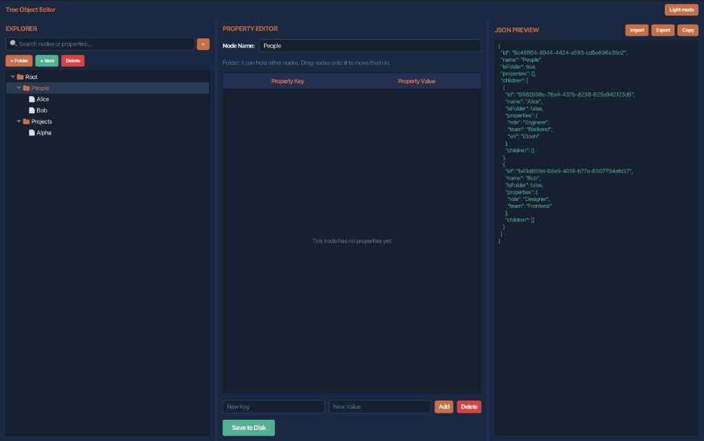
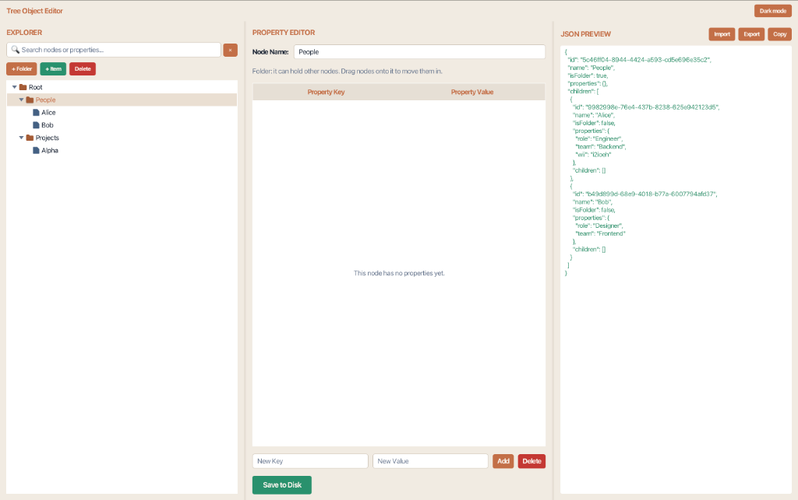
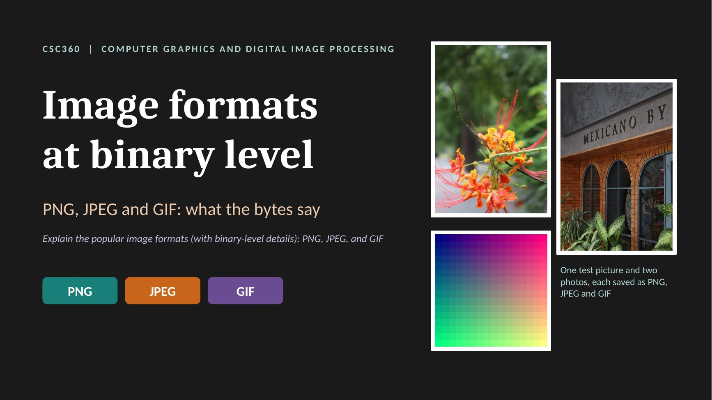
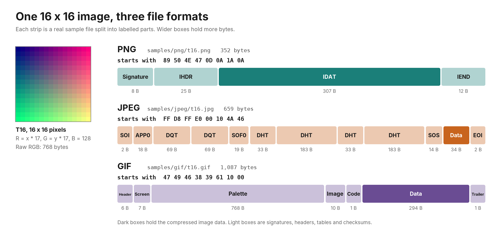

# CSC360 - Computer Graphics and Digital Image Processing

**Ahmedabad University · School of Arts and Sciences · Monsoon Semester 2026**

---

## About Me

- **Name:** Yug Bangoriya
- **Enrollment ID:** AU2420014
- **Semester:** 5th, Monsoon 2026

---

## Course

- **Code:** CSC360
- **Name:** Computer Graphics and Digital Image Processing
- **Faculty:** Susanta Tewari

---

## About the Course

CSC360 introduces the fundamental concepts of computer graphics and digital image processing. The first half covers two-dimensional graphics, geometric transformations, and algorithms for drawing lines, curves, and areas, with hands-on programming in Java 2D and JavaFX. The second half gets into digital image processing, including image acquisition, histogram analysis, filtering, and edge detection, using ImageJ for practical work. The course runs on a Project-Based Learning approach. This semester we did two group projects, and each one ended with a presentation in class.

---

## What's in This Repository

This is my coursework repository for CSC360. It covers the whole semester, from Session 1 on 04/08/26 to Session 26 on 17/11/26, and holds everything that came out of class.

### Daily Reflection Journals

After each class, I wrote a reflection as part of the course requirement. There are 26 of them, one for each session. Each entry covers what was taught, what clicked, what I struggled with, and connections I noticed to earlier sessions. Some sessions were project work or presentations and not lectures (Sessions 12 to 14, 16 to 19, and 24 to 26), so those entries are about the projects, which are also part of the learning method and focus on peer learning under the professor's supervision.

**The semester at a glance**

- **Sessions 1 to 7:** Course setup, development environment, basic Java 2D drawing, pixels, OOP, Maven, and build tools.
- **Sessions 8 to 11:** Group project briefs, linear algebra and geometry in JavaFX, test-driven development, events in graphics, UI design, and a first look at image processing.
- **Sessions 12 to 19:** The first group project, a JavaFX tree editor. We built it, planned new features, polished it, and then presented it. Session 15 covered generics and JavaFX shape abstraction, and Sessions 16 to 19 were the presentations from all 12 groups.
- **Sessions 20 and 21:** GitHub standards for a professional repository, code quality, creativity, and what AI changes about building software.
- **Sessions 22 and 23:** Contrast, histograms, convolution, and edge detection, followed by how pixels are stored in memory, RGBA, byte order, and endianness.
- **Sessions 24 to 26:** The end-sem project on PNG, JPEG, and GIF at the binary level, ending with presentations from all 12 groups.

**Index of reflections**

| Session | Date | Topic |
|:-------:|:----:|:------|
| 1 | 04/08/26 | [Introduction to Course](Daily_Reflection_Journals/Session_01_04.08.26.md) |
| 2 | 07/08/26 | [Getting Started with the Course](Daily_Reflection_Journals/Session_02_07.08.26.md) |
| 3 | 13/08/26 | [Development Environment Setup and Basic Java 2D Drawing](Daily_Reflection_Journals/Session_03_13.08.26.md) |
| 4 | 18/08/26 | [Pixels, Square Geometry Algorithm and Project Organisation Conventions](Daily_Reflection_Journals/Session_04_18.08.26.md) |
| 5 | 20/08/26 | [Markdown Best Practices, Java Syntax Revisited and OOP Fundamentals](Daily_Reflection_Journals/Session_05_20.08.26.md) |
| 6 | 25/08/26 | [Maven, Thread Safety and the Java 2D Complexity Roadmap](Daily_Reflection_Journals/Session_06_25.08.26.md) |
| 7 | 27/08/26 | [Java Build Artifacts, CI/CD Workflows and Encoding Systems](Daily_Reflection_Journals/Session_07_27.08.26.md) |
| 8 | 01/09/26 | [Group Projects, Linear Algebra and Drawing Geometry in JavaFX](Daily_Reflection_Journals/Session_08_01.09.26.md) |
| 9 | 03/09/26 | [Group Projects Discussion, Headless Systems and Test-Driven Development](Daily_Reflection_Journals/Session_09_03.09.26.md) |
| 10 | 08/09/26 | [Course Textbooks, Events in Graphics and UI Design Principles](Daily_Reflection_Journals/Session_10_08.09.26.md) |
| 11 | 10/09/26 | [Moving to Image Processing, Statistics, Rendering and Storage](Daily_Reflection_Journals/Session_11_10.09.26.md) |
| 12 | 15/09/26 | [Project's First Demo - Project Build and Faculty Approval](Daily_Reflection_Journals/Session_12_15.09.26.md) |
| 13 | 17/09/26 | [Project Feature Planning - Dark Mode, Drag and Drop and UI Refresh](Daily_Reflection_Journals/Session_13_17.09.26.md) |
| 14 | 29/09/26 | [Last In-Class Sprint: Splash Screen and Project Documentation](Daily_Reflection_Journals/Session_14_29.09.26.md) |
| 15 | 01/10/26 | [Functionality, Generics, and JavaFX Shape Abstraction](Daily_Reflection_Journals/Session_15_01.10.26.md) |
| 16 | 06/10/26 | [Presenting Is Not the Same as Building: Project Demos and Interview Q&A](Daily_Reflection_Journals/Session_16_06.10.26.md) |
| 17 | 08/10/26 | [When the Problem Shapes the Stack: Project Presentations from Groups 4, 5, and 6](Daily_Reflection_Journals/Session_17_08.10.26.md) |
| 18 | 13/10/26 | [Our Turn to Present: A Tree Editor, Concurrent Jobs, and a JavaFX-Swing Hybrid](Daily_Reflection_Journals/Session_18_13.10.26.md) |
| 19 | 15/10/26 | [Geometric Styling, a Library Browser, and the Final Presentation Round](Daily_Reflection_Journals/Session_19_15.10.26.md) |
| 20 | 22/10/26 | [GitHub as the Silent Resume: Five Standards for a Professional Repository](Daily_Reflection_Journals/Session_20_22.10.26.md) |
| 21 | 27/10/26 | [Code Quality, Creativity, and What AI Actually Changes About Building Software](Daily_Reflection_Journals/Session_21_27.10.26.md) |
| 22 | 29/10/26 | [From Pixels to Meaning: Contrast, Histograms, Convolution, and Edge Detection](Daily_Reflection_Journals/Session_22_29.10.26.md) |
| 23 | 03/11/26 | [What a Pixel Looks Like in Memory: RGBA, Byte Order, and Endianness](Daily_Reflection_Journals/Session_23_03.11.26.md) |
| 24 | 05/11/26 | [Project Kickoff - Researching PNG, JPEG, and GIF at the Binary Level](Daily_Reflection_Journals/Session_24_05.11.26.md) |
| 25 | 12/11/26 | [Class Participation Grading and Back to the Project After the Break](Daily_Reflection_Journals/Session_25_12.11.26.md) |
| 26 | 17/11/26 | [The Last Session: Twelve Image Projects and a Look Back at the Course](Daily_Reflection_Journals/Session_26_17.11.26.md) |

### Group Projects

There were two group projects this semester, and I worked on both as part of Group 7. The code for each one lives in its own repository, so the buttons under each project open its repository and wiki.

#### Project 1: Grove (Tree of Objects Editor)

  
  
  

<table>
  <tr>
    <td width="50%"></td>
    <td width="50%"></td>
  </tr>
  <tr>
    <td align="center">Dark theme</td>
    <td align="center">Light theme</td>
  </tr>
</table>

- **Task:** Write a JavaFX program with a tree of objects, with support for editing each object.
- **What we built:** Grove, a JavaFX desktop app for building, browsing, and editing tree-structured data. Every node is either a Folder or an Item, and each one has a name and key-value properties. It has real-time search, drag and drop, JSON import and export, light and dark themes, and auto-save.
- **Built with:** Java 17, JavaFX 21, and Maven.
- **Presented:** Session 18 (13/10/26).

#### Project 2: PNG, JPEG, and GIF at the Binary Level (End-Sem Project)

  
  
  

Title slide of our end-sem presentation

The same 16 x 16 test image as PNG, JPEG, and GIF, with each file split into labelled parts

- **Topic:** Explain the popular image formats (with binary-level details): PNG, JPEG, and GIF.
- **What we did:** We saved one 16 x 16 test image as a PNG, a JPEG, and a GIF. Then we read each file byte by byte with Java, labelled every part, and checked that no byte was left out. The same image takes 352 bytes as a PNG, 659 bytes as a JPEG, and 1,087 bytes as a GIF, while the raw RGB data is 768 bytes.
- **My part:** The PNG section, which has the PNG chunk parser, the demos, and the research write-up.
- **Built with:** Java 17 or newer, with no extra libraries.
- **Presented:** Session 26 (17/11/26).

---

